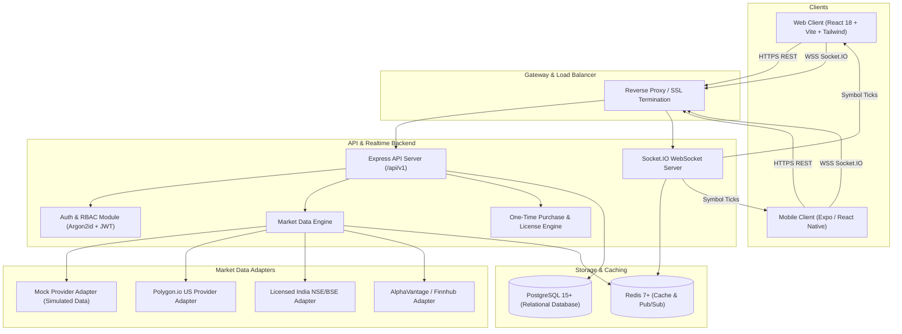

# System Architecture Document
**Global Stock Market Information Platform (NSE, BSE, NASDAQ, NYSE)**

---

## 1. High-Level System Architecture



---

## 2. Monorepo Organization

```
stoke-market/
├── apps/
│   ├── api/                   # Node.js + TypeScript + Express backend
│   │   ├── src/
│   │   │   ├── config/        # Environment & system configurations
│   │   │   ├── controllers/   # Route controllers (Auth, Markets, Stocks, etc.)
│   │   │   ├── middlewares/   # Auth, RBAC, error handling, rate limiting
│   │   │   ├── models/        # Prisma client instantiation
│   │   │   ├── providers/     # Market data provider adapters
│   │   │   ├── routes/        # Versioned API routes (/api/v1)
│   │   │   ├── services/      # Business logic (Alerts, Licensing, Market Engine)
│   │   │   ├── websocket/     # Socket.IO connection & room manager
│   │   │   └── server.ts      # Server entrypoint
│   │   ├── prisma/            # Prisma schema, migrations & seed scripts
│   │   └── package.json
│   │
│   ├── web/                   # React + TypeScript + Vite web app
│   │   ├── src/
│   │   │   ├── assets/        # Static imagery & logos
│   │   │   ├── components/    # Common UI & domain components
│   │   │   │   ├── charts/    # Lightweight Charts candlestick, line, area
│   │   │   │   ├── layout/    # Topbar, Sidebar, MobileNav, Footer
│   │   │   │   ├── markets/   # Index cards, sector heatmaps, market status
│   │   │   │   ├── screener/  # Dynamic stock screener filters & table
│   │   │   │   └── ui/        # Reusable buttons, cards, modals, tabs, badge
│   │   │   ├── context/       # Auth and Realtime Socket context
│   │   │   ├── hooks/         # Custom React hooks (useMarketData, useQuote)
│   │   │   ├── pages/         # Route views (Dashboard, StockDetail, Screener, Admin, Store)
│   │   │   ├── store/         # Zustand global stores (watchlistStore, themeStore)
│   │   │   ├── App.tsx
│   │   │   └── main.tsx
│   │   └── package.json
│   │
│   └── mobile/                # React Native Expo app
│       ├── src/
│       │   ├── app/           # Expo Router screens
│       │   ├── components/    # Native UI components
│       │   ├── hooks/         # Shared state hooks
│       │   └── theme/         # Design tokens for React Native
│       └── package.json
│
├── packages/
│   ├── shared-types/          # Universal TypeScript interfaces
│   ├── validation/            # Zod input validation schemas
│   ├── shared-utils/          # Technical indicators, currency formatters, timezone tools
│   ├── design-tokens/         # Colors, typography, spacing, financial status tokens
│   └── api-client/            # Typed REST & WebSocket client
│
├── infrastructure/
│   ├── docker/
│   └── nginx/
│
├── PROJECT_PLAN.md
├── ARCHITECTURE.md
├── DATABASE_SCHEMA.md
├── API_DOCUMENTATION.md
├── DEVELOPMENT_PROGRESS.md
├── PENDING_TASKS.md
├── docker-compose.yml
└── package.json
```

---

## 3. Market Data Adapter Pattern & Data Normalization

All market data sources adhere to the strict `IMarketDataProvider` contract:

```typescript
export interface IMarketDataProvider {
  readonly providerId: string;
  readonly name: string;
  readonly isMock: boolean;
  
  initialize(): Promise<void>;
  getQuote(symbol: string): Promise<NormalizedQuote>;
  getBatchQuotes(symbols: string[]): Promise<Map<string, NormalizedQuote>>;
  getHistoricalCandles(symbol: string, timeframe: Timeframe, from: Date, to: Date): Promise<Candle[]>;
  getCompanyProfile(symbol: string): Promise<CompanyProfile>;
  getFinancialStatements(symbol: string): Promise<FinancialStatements>;
  getNews(market?: 'IN' | 'US', symbol?: string, limit?: number): Promise<NewsArticle[]>;
  subscribeRealtime(symbols: string[], callback: (tick: MarketTick) => void): () => void;
}
```

### Data Normalization Guarantee
Regardless of whether data originates from NSE, BSE, Polygon, AlphaVantage, or the Mock generator, every quote is normalized to:
- `symbol`: Unified symbol identifier (e.g. `RELIANCE.NS`, `TCS.BO`, `AAPL.US`, `MSFT.US`).
- `exchange`: `NSE`, `BSE`, `NASDAQ`, `NYSE`.
- `market`: `IN` or `US`.
- `currency`: `INR` or `USD`.
- `price`, `open`, `high`, `low`, `previousClose`, `volume`, `change`, `changePercent`.
- `isSimulated`: Explicit flag indicating mock or real exchange feed.
- `delayMinutes`: 0 for real-time (when licensed), 15 for delayed feeds.
- `asOf`: Precise ISO timestamp.

---

## 4. Real-Time WebSocket Channel Strategy
To prevent high-bandwidth broadcast flooding:
- **Client Rooms**: Clients subscribe selectively via Socket.IO events: `subscribe:symbol` and `unsubscribe:symbol`.
- **Server Multiplexing**: The server joins the socket to a room keyed by symbol (e.g. `sym:AAPL.US`). Only ticks for that symbol are emitted into that room.
- **Debounced Throttling**: Ticks are aggregated or throttled at 250ms intervals per active symbol to ensure smooth UI 60fps rendering without DOM choke.

---

## 5. Security & Authentication Model
- **Hashing**: Argon2id with 3 iterations, 64MB memory cost, 4 parallelism lanes (with standard bcrypt fallback where compiled binaries are restricted).
- **Tokens**: Dual-token architecture (Short-lived access JWT 15m + Long-lived refresh token 7d stored with rotation and revocation blacklist in DB/Redis).
- **RBAC**: Fine-grained roles:
  - `SUPER_ADMIN`: System configuration, data provider keys, full audit trail.
  - `ADMIN`: User management, order approval, license management.
  - `PRO_USER`: Real-time streaming, advanced technical indicators, unlimited watchlists, export.
  - `FREE_USER`: Delayed quotes, standard charts, basic watchlist (max 10 items).

---

## 6. One-Time Purchase & Transparent Licensing Model
1. **The Economic Reality**: Cloud-hosted real-time financial market exchange fees are recurring variable costs.
2. **Platform Solution**: 
   - Platform software is sold on a **Perpetual One-Time License** (Core Terminal, Desktop/Web/Mobile software, Advanced Charting Engine, Technical Screeners, Custom Alerts, Local Data Export).
   - The license includes 1 Year of included Real-time Data Connector Access via licensed aggregation gateways.
   - Users can either extend the data connector or configure their own personal broker/exchange API keys (Zerodha Kite, Upstox, Interactive Brokers, Alpaca, Polygon) for direct zero-margin real-time access.
3. **License Keys**: Cryptographically signed HMAC-SHA256 tokens linked to machine/device fingerprints with configurable maximum concurrent activations.

