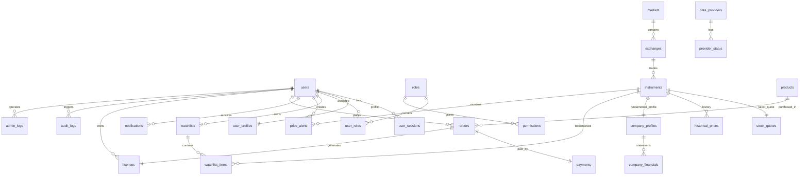

# Database Schema Documentation
**PostgreSQL & Prisma Data Architecture**

---

## 1. Schema Overview

The database is designed with 24 relational tables organized into 6 logical domains:
1. **Identity & Access Management (IAM)**: `users`, `user_profiles`, `user_sessions`, `roles`, `permissions`, `user_roles`.
2. **Markets & Instruments**: `markets`, `exchanges`, `instruments`, `stock_quotes`, `historical_prices`.
3. **User Engagement**: `watchlists`, `watchlist_items`, `price_alerts`, `notifications`.
4. **Fundamentals & Intelligence**: `company_profiles`, `company_financials`, `market_news`.
5. **Data Engine & Providers**: `data_providers`, `provider_status`.
6. **Commerce & Licensing**: `products`, `orders`, `payments`, `licenses`.
7. **Security & Auditing**: `admin_logs`, `audit_logs`.

---

## 2. Table Specifications & Relationships

---

## 3. Detailed Entity Fields

### Identity & Access Control
- **`users`**:
  - `id` (UUID, PK)
  - `email` (VARCHAR, UNIQUE, INDEXED)
  - `passwordHash` (TEXT, Argon2id)
  - `firstName` (VARCHAR), `lastName` (VARCHAR)
  - `isEmailVerified` (BOOLEAN, default: false)
  - `status` (`ACTIVE`, `SUSPENDED`, `PENDING_VERIFICATION`)
  - `twoFactorEnabled` (BOOLEAN, default: false)
  - `twoFactorSecret` (TEXT, nullable)
  - `createdAt`, `updatedAt`

- **`user_profiles`**:
  - `id` (UUID, PK)
  - `userId` (UUID, FK -> users.id, UNIQUE)
  - `theme` (`DARK`, `LIGHT`, `SYSTEM`, default: `DARK`)
  - `preferredCurrency` (`INR`, `USD`, default: `INR`)
  - `defaultMarket` (`IN`, `US`, `ALL`, default: `IN`)
  - `timezone` (VARCHAR, default: `Asia/Kolkata`)
  - `avatarUrl` (TEXT, nullable)
  - `bio` (TEXT, nullable)

- **`user_sessions`**:
  - `id` (UUID, PK)
  - `userId` (UUID, FK -> users.id)
  - `refreshTokenHash` (TEXT, INDEXED)
  - `deviceInfo` (VARCHAR)
  - `ipAddress` (VARCHAR)
  - `expiresAt` (TIMESTAMP)
  - `revokedAt` (TIMESTAMP, nullable)

- **`roles` & `permissions`**:
  - `roles`: `id`, `name` (`SUPER_ADMIN`, `ADMIN`, `ANALYST`, `PRO_USER`, `FREE_USER`), `description`.
  - `permissions`: `id`, `action`, `resource` (`quote:read`, `alerts:create`, `admin:manage`, etc.).
  - `user_roles`: `userId`, `roleId` (Composite PK).

---

### Markets & Instruments
- **`markets`**:
  - `id` (VARCHAR PK: `IN`, `US`)
  - `name` (VARCHAR: `India`, `United States`)
  - `currency` (VARCHAR: `INR`, `USD`)
  - `timezone` (VARCHAR: `Asia/Kolkata`, `America/New_York`)
  - `tradingHoursStart` (VARCHAR: `09:15`, `09:30`)
  - `tradingHoursEnd` (VARCHAR: `15:30`, `16:00`)
  - `status` (`OPEN`, `CLOSED`, `PRE_MARKET`, `AFTER_HOURS`, `HOLIDAY`)

- **`exchanges`**:
  - `id` (VARCHAR PK: `NSE`, `BSE`, `NASDAQ`, `NYSE`)
  - `marketId` (VARCHAR, FK -> markets.id)
  - `fullName` (VARCHAR)
  - `country` (VARCHAR)
  - `website` (VARCHAR)

- **`instruments`**:
  - `id` (UUID, PK)
  - `symbol` (VARCHAR, UNIQUE, INDEXED - e.g. `RELIANCE.NS`, `AAPL.US`, `NIFTY50.IDX`)
  - `ticker` (VARCHAR, INDEXED - e.g. `RELIANCE`, `AAPL`)
  - `name` (VARCHAR)
  - `exchangeId` (VARCHAR, FK -> exchanges.id)
  - `marketId` (VARCHAR, FK -> markets.id)
  - `type` (`STOCK`, `INDEX`, `ETF`, `MUTUAL_FUND`)
  - `sector` (VARCHAR, nullable)
  - `industry` (VARCHAR, nullable)
  - `isin` (VARCHAR, nullable)
  - `isActive` (BOOLEAN, default: true)

- **`stock_quotes`** (Latest State Cache):
  - `id` (UUID, PK)
  - `instrumentId` (UUID, FK -> instruments.id, UNIQUE)
  - `price` (DECIMAL(14, 4))
  - `previousClose` (DECIMAL(14, 4))
  - `open` (DECIMAL(14, 4))
  - `high` (DECIMAL(14, 4))
  - `low` (DECIMAL(14, 4))
  - `volume` (BIGINT)
  - `change` (DECIMAL(14, 4))
  - `changePercent` (DECIMAL(8, 4))
  - `day52WeekHigh` (DECIMAL(14, 4))
  - `day52WeekLow` (DECIMAL(14, 4))
  - `marketCap` (DECIMAL(20, 2))
  - `peRatio` (DECIMAL(10, 2), nullable)
  - `isSimulated` (BOOLEAN, default: false)
  - `delayMinutes` (INTEGER, default: 0)
  - `lastTradeAt` (TIMESTAMP)
  - `updatedAt` (TIMESTAMP)

- **`historical_prices`**:
  - `id` (UUID, PK)
  - `instrumentId` (UUID, FK -> instruments.id)
  - `timestamp` (TIMESTAMP, INDEXED with instrumentId)
  - `open` (DECIMAL(14, 4))
  - `high` (DECIMAL(14, 4))
  - `low` (DECIMAL(14, 4))
  - `close` (DECIMAL(14, 4))
  - `volume` (BIGINT)
  - `timeframe` (`1m`, `5m`, `15m`, `1h`, `1d`, `1w`, `1mo`)
  - `isSimulated` (BOOLEAN, default: false)

---

### Commerce, Orders & Licensing
- **`products`**:
  - `id` (UUID, PK)
  - `slug` (VARCHAR, UNIQUE - `terminal-pro-lifetime`, `terminal-enterprise-lifetime`)
  - `name` (VARCHAR)
  - `description` (TEXT)
  - `priceINR` (INTEGER in paise)
  - `priceUSD` (INTEGER in cents)
  - `maxActivations` (INTEGER, default: 3 devices)
  - `dataIncludedDays` (INTEGER, default: 365)
  - `features` (JSONB)
  - `isActive` (BOOLEAN, default: true)

- **`orders`**:
  - `id` (UUID, PK)
  - `orderNumber` (VARCHAR, UNIQUE)
  - `userId` (UUID, FK -> users.id)
  - `productId` (UUID, FK -> products.id)
  - `currency` (`INR`, `USD`)
  - `amount` (INTEGER)
  - `tax` (INTEGER)
  - `status` (`PENDING`, `COMPLETED`, `FAILED`, `REFUNDED`)
  - `createdAt`, `updatedAt`

- **`payments`**:
  - `id` (UUID, PK)
  - `orderId` (UUID, FK -> orders.id, UNIQUE)
  - `gateway` (`RAZORPAY`, `STRIPE`, `MANUAL_INVOICE`, `MOCK_SANDBOX`)
  - `gatewayPaymentId` (VARCHAR, nullable)
  - `gatewaySignature` (VARCHAR, nullable)
  - `status` (`SUCCESS`, `PENDING`, `FAILED`)
  - `metadata` (JSONB)
  - `paidAt` (TIMESTAMP, nullable)

- **`licenses`**:
  - `id` (UUID, PK)
  - `licenseKey` (VARCHAR, UNIQUE, INDEXED: `STK-XXXX-XXXX-XXXX-XXXX`)
  - `orderId` (UUID, FK -> orders.id, UNIQUE)
  - `userId` (UUID, FK -> users.id)
  - `status` (`ACTIVE`, `SUSPENDED`, `EXPIRED`, `REVOKED`)
  - `maxDevices` (INTEGER)
  - `activeDevices` (JSONB: array of `{ deviceId, os, name, activatedAt, lastSeenAt }`)
  - `dataAccessExpiry` (TIMESTAMP)
  - `softwareAccessExpiry` (TIMESTAMP, nullable for perpetual)
  - `signature` (TEXT, HMAC-SHA256 signature for offline verification)

---

### User Engagement & Intelligence
- **`watchlists`**: `id`, `userId`, `name`, `isDefault`, `createdAt`.
- **`watchlist_items`**: `id`, `watchlistId`, `instrumentId`, `sortOrder`, `addedAt`.
- **`price_alerts`**: `id`, `userId`, `instrumentId`, `condition` (`ABOVE`, `BELOW`, `PCT_CHANGE_UP`, `PCT_CHANGE_DOWN`), `targetPrice`, `triggered`, `triggeredAt`, `isActive`.
- **`notifications`**: `id`, `userId`, `title`, `body`, `type` (`ALERT`, `SYSTEM`, `ORDER`), `read`, `createdAt`.
- **`company_profiles`**: `id`, `instrumentId` (UNIQUE), `description`, `ceo`, `employees`, `headquarters`, `website`.
- **`company_financials`**: `id`, `companyProfileId`, `fiscalYear`, `fiscalQuarter`, `revenue`, `netIncome`, `eps`, `ebitda`, `peRatio`, `pbRatio`, `debtToEquity`, `periodEndDate`.
- **`market_news`**: `id`, `marketId`, `title`, `summary`, `content`, `source`, `url`, `publishedAt`, `sentiment` (`BULLISH`, `BEARISH`, `NEUTRAL`), `relatedSymbols` (TEXT[]).
- **`data_providers`**: `id`, `name`, `code` (`MOCK`, `POLYGON`, `NSE_LICENSED`, `ALPHA_VANTAGE`), `isActive`, `status` (`ONLINE`, `DEGRADED`, `OFFLINE`), `latencyMs`, `quotaLimit`, `quotaUsed`.
- **`audit_logs` & `admin_logs`**: `id`, `userId`, `action`, `resource`, `ipAddress`, `userAgent`, `payload`, `createdAt`.

